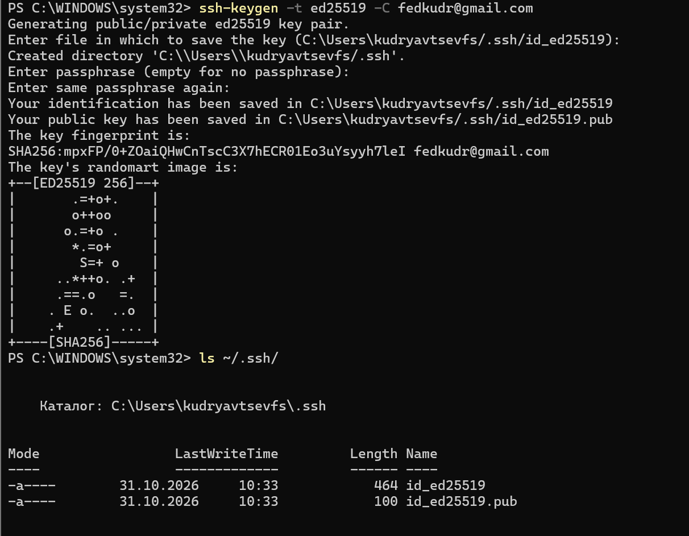
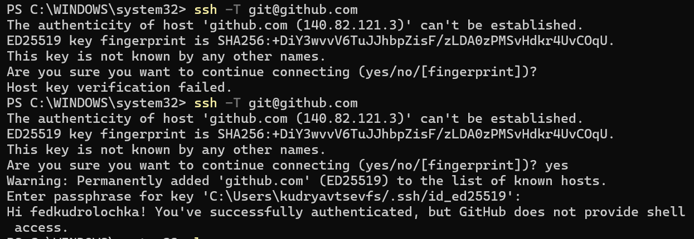
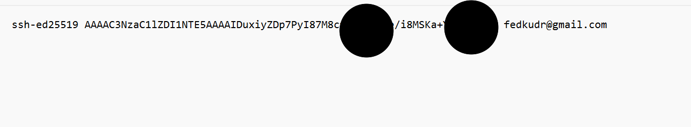
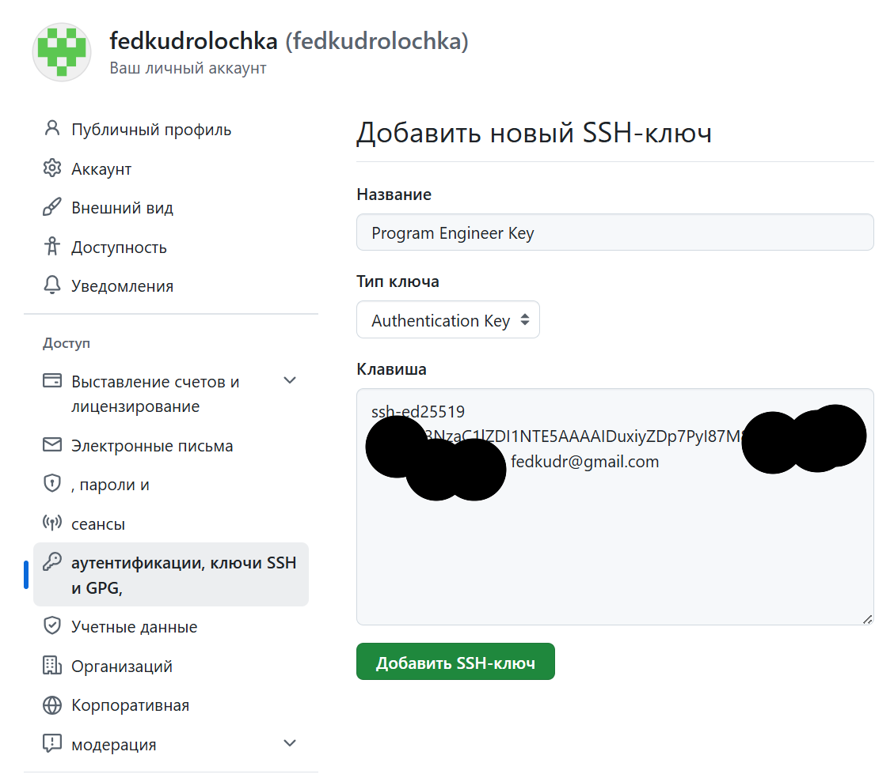
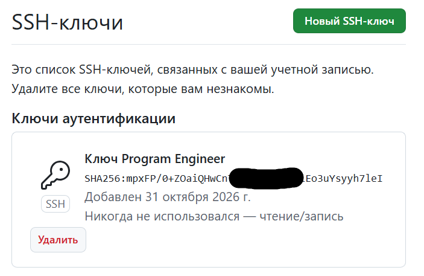
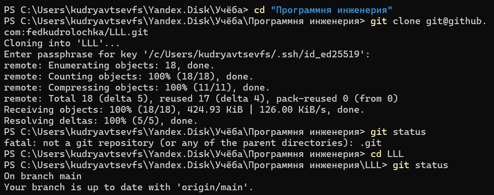
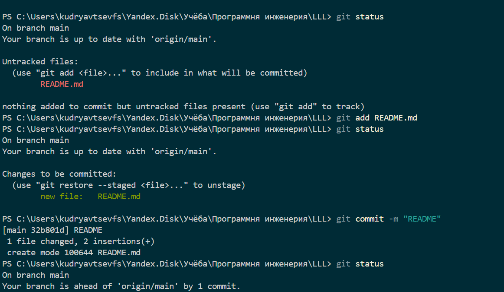
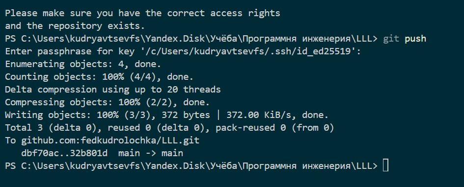

#  ДЗ №3 Работа с серверами и протокол удалённого управления SSH

## Установка SSH клиента
### Проверяем наличие SSH 

 ### Сгенерирована пара SSH-ключей алгоритма Ed25519
 

### Проверяем наличие пароля, (passphrase). Git запрашивает при подключении. Проверена установка соединения с ГИТ

### Скопировано содержимое файла в гит

### Создан SSH-ключ

### Склонирован репозиторий

### Создан комит

### Произведена команда git push

